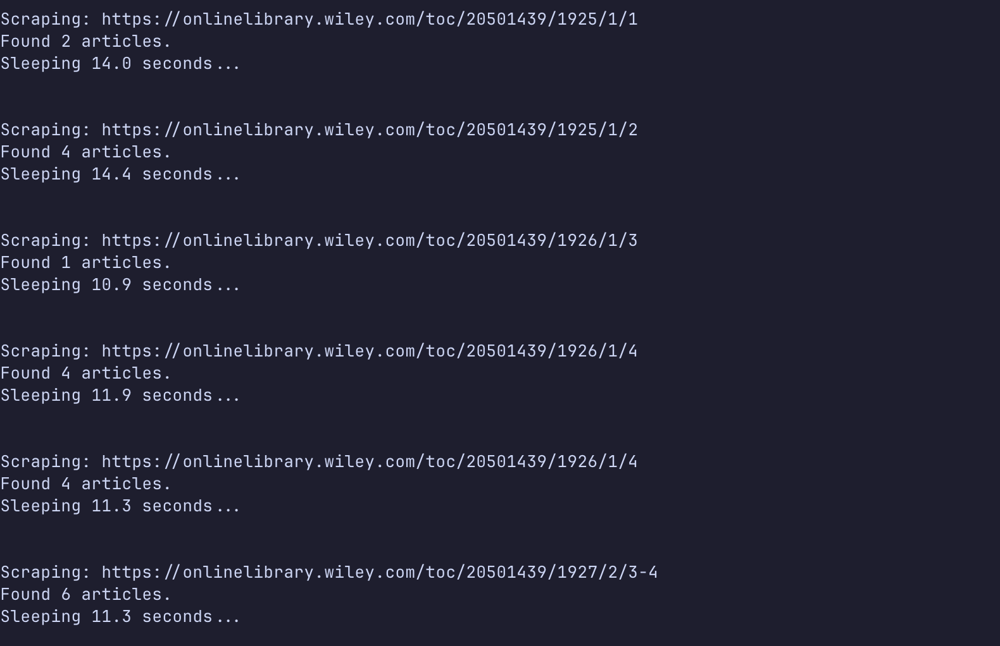

# Introduction

This project examines the *Annals of Eugenics*, a scientific journal published from 1925 to 1954 before being renamed the *Annals of Human Genetics*. Through quantitative analysis of publication metadata, this study explores patterns in authorship, research topics, and publication trends during a controversial period in the history of genetics and statistics.

## Context and Motivation

This analysis is part of a larger investigation into the history of eugenics in academia, particularly at The College of Idaho and within the state of Idaho. Understanding what was published in the *Annals of Eugenics* provides insight into the type of research that was considered legitimate science during this era and how the field evolved over time.

## Research Questions

1.  How did publication volume change over the journal's 29-year run?
2.  Which researchers were the most prolific contributors to the journal?
3.  What topics dominated the research published in the *Annals of Eugenics*?

## About the Dataset

**Data Source:** The *Annals of Eugenics* online archive\
**Collection Method:** Web scraping using Python (BeautifulSoup, requests)\
**Time Period:** 1925-1954 (Volumes 1-18)\
**Data Points:** Article titles, authors, publication dates, volume/issue numbers

The dataset was constructed by scraping article metadata directly from the journal's online archive, then cleaned and normalized for analysis.

# Data Collection

## Web Scraping Implementation

I developed a Python script to systematically extract article metadata from the journal archive. The scraper navigates through each volume and issue, collecting titles, authors, and publication dates.

[**View the complete scraping script on GitHub →**](https://github.com/ashleymikali/eugenics-journal-graphs/blob/main/article-gatherer.py)

Key challenges included: - Handling inconsistent formatting across different volumes - Extracting author names with various academic titles and credentials - Parsing dates from different formats



# Data Processing

```{python}
#| label: import-packages
#| code-summary: "Import Python libraries"

import pandas as pd
import matplotlib.pyplot as plt
from wordcloud import WordCloud
import re
from sklearn.feature_extraction.text import ENGLISH_STOP_WORDS
from collections import Counter
import seaborn as sns
from tabulate import tabulate

# Set visualization style
sns.set_palette("viridis")
plt.style.use('seaborn-v0_8-darkgrid')
```

```{python}
#| label: load-data
#| code-summary: "Load the scraped dataset"

df = pd.read_csv("data/articles.csv")
```

## Data Preview

```{python}
#| label: preview-data
#| code-summary: "Display first few rows of the dataset"

print(tabulate(df.head(), headers='keys', tablefmt='github', showindex=False))
```

## Data Cleaning

### Temporal Data

Converting publication dates to a standardized format for time-series analysis:

```{python}
#| label: parse-dates
#| code-summary: "Parse dates and extract year/month"

df["parsed_date"] = pd.to_datetime(df["date"], format="%B %Y", errors="coerce")
df["year"] = df["parsed_date"].dt.year
df["month"] = df["parsed_date"].dt.month

# Verify date parsing worked
print(f"Date range: {df['year'].min():.0f} to {df['year'].max():.0f}")
print(f"Total articles: {len(df)}")
```

### Author Name Normalization

Author names required extensive cleaning due to: - Academic titles (Dr., Professor, Sir) - Degrees and credentials (M.D., Ph.D., F.R.S., etc.) - Institutional affiliations in parentheses - Inconsistent formatting (e.g., "M. N. Karn" vs "Mary N. Karn")

**Strategy:** Normalize all authors to `FirstInitial_LASTNAME` format to handle variations while preserving identity.

```{python}
#| label: parse-authors
#| code-summary: "Split author strings into lists"

def clean_authors(x):
    """Split comma-separated author strings into lists."""
    if pd.isna(x):
        return []
    parts = [p.strip() for p in x.split(",") if p.strip()]
    return parts

df["author_list"] = df["authors"].apply(clean_authors)
```

```{python}
#| label: degree-patterns
#| code-summary: "Define regex patterns for academic credentials"

# Academic degrees and credentials to remove
degree_patterns = [
    r"M\.?O\.?H\.?", r"M\.?B\.?", r"M\.?A\.?", r"B\.?S\.?C\.?",
    r"R\.?A\.?M\.?C\.?", r"F\.?R\.?S\.?", r"D\.?P\.?H\.?", r"M\.?D\.?",
    r"D\.?\s*S\.?C\.?", r"D\.?S\.?C\.?", r"P\.?R\.?C\.?S\.?",
    r"M\.?R\.?C\.?P\.?", r"M\.?R\.?C\.?P\.?Ed", r"B\.?S\.?",
    r"B\.?Sc\.?", r"C\.?H\.?I\.?B\.?", r"F\.?R\.?C\.?S\.?",
    r"P\.?H\.?D\.?", r"P\.?R\.?S\.?", r"M\.?S\.?C\.?",
    r"C\.?H\.?B\.?", r"N\.?Z\.?", r"S\.?C\.?D\.?",
    r"A\.?B\.?", r"B\.?A\.?", r"M\.?S\.?A\.?",
    r"D\.?P\.?S\.?Y\.?C\.?H\.?", r"R\.?M\.?C\.?", r"D\.?P\.?M\.?",
    r"B\.?S\.?\s*\(?LOND\)?", r"M\.?A\.?\s*CANTAB\.?",
    r"B\.?C\.?H\.?\s*\(?CAMB\)?", r"B\.?C\.?H\.?",
    r"D\.?M\.?\s*\(?OXON\)?", r"D\.?M\.?",
    r"B\.?\s*C\.?H\.?I\.?B\.?\s*\(?CAMB\.?\)?", r"M\.?\s*S\.?C\.?",
]

degree_regex = re.compile(
    r"\b(?:" + "|".join(degree_patterns) + r")\b",
    flags=re.IGNORECASE
)

titles = re.compile(r"\b(Dr|Professor|Sir)\b", flags=re.IGNORECASE)
```

```{python}
#| label: clean-author-function
#| code-summary: "Author name cleaning function"

def clean_author(name):
    """
    Normalize author names to FirstInitial_LASTNAME format.
    
    Example: "Dr. Mary N. Karn, M.D." → "M_KARN"
    """
    if not isinstance(name, str) or not name.strip():
        return None

    # Remove titles (Dr., Professor, Sir)
    name = titles.sub("", name)

    # Remove parenthetical suffixes (institutional affiliations)
    name = re.sub(r"\([^)]*\)", "", name)

    # Remove degrees and credentials
    name = degree_regex.sub("", name)

    # Remove periods and normalize whitespace
    name = name.replace(".", " ")
    name = re.sub(r"\s+", " ", name).strip()

    if not name:
        return None

    parts = [p for p in name.split() if p]
    if len(parts) == 0:
        return None

    # Extract surname (last token) and first initial
    last = parts[-1].upper()
    first_initial = parts[0][0].upper()

    return f"{first_initial}_{last}"

# Apply cleaning function to all authors
df["clean_authors"] = df["author_list"].apply(
    lambda lst: [clean_author(a) for a in lst if clean_author(a) is not None]
)
```

### Title Cleaning

Preparing article titles for text analysis:

```{python}
#| label: clean-titles
#| code-summary: "Normalize article titles"

df["clean_title"] = (
    df["title"]
    .str.lower()
    .str.replace(r"[^a-z0-9\s]", "", regex=True)
    .str.replace(r"\s+", " ", regex=True)
    .str.strip()
)
```

# Analysis and Visualization

## Publication Trends Over Time

How did the volume of publications change during the journal's run?

```{python}
#| label: yearly-counts
#| code-summary: "Calculate articles per year"

year_counts = df["year"].value_counts().sort_index()
print("Articles published per year:")
print(year_counts)
```

```{python}
#| label: fig-publications-timeline
#| fig-cap: "Number of articles published in the Annals of Eugenics by year (1925-1954)"

plt.figure(figsize=(12, 6))
plt.plot(year_counts.index, year_counts.values, marker="o", linewidth=2, markersize=8)
plt.xlabel("Year", fontsize=12)
plt.ylabel("Number of Articles", fontsize=12)
plt.title("Publication Volume in Annals of Eugenics (1925-1954)", fontsize=14, fontweight='bold')
plt.grid(True, alpha=0.3)
plt.tight_layout()
plt.show()
```

**Key Findings:** - Publication volume shows clear trends over the journal's lifespan - Notable peaks and valleys may correspond to historical events (WWII, post-war period) - The journal maintained consistent output across most years

## Research Topics

What themes dominated the research published in this journal?

```{python}
#| label: word-frequency-analysis
#| code-summary: "Extract and count frequent words in titles"

# Combine all titles and remove stop words
all_titles = ' '.join(df['clean_title']).lower()
all_titles = re.sub(r'[^\w\s]', '', all_titles)

words = all_titles.split()
filtered_words = [word for word in words if word not in ENGLISH_STOP_WORDS]

word_counts = Counter(filtered_words)
```

```{python}
#| label: fig-word-cloud
#| fig-cap: "Most frequent terms in article titles (sized by frequency)"

wordcloud = WordCloud(
    width=1200,
    height=600,
    background_color='white',
    colormap='viridis',
    relative_scaling=0.5
).generate_from_frequencies(word_counts)

plt.figure(figsize=(16, 8))
plt.imshow(wordcloud, interpolation='bilinear')
plt.axis('off')
plt.title("Most Frequent Terms in Article Titles", fontsize=16, fontweight='bold', pad=20)
plt.tight_layout()
plt.show()
```

```{python}
#| label: top-words-table
#| code-summary: "Top 10 most frequent words"

top_words = word_counts.most_common(10)
df_top_words = pd.DataFrame(top_words, columns=['Word', 'Frequency'])
print("\nTop 10 Most Frequent Words in Titles:")
print(tabulate(df_top_words, headers='keys', tablefmt='github', showindex=False))
```

```{python}
#| label: fig-top-words-bar
#| fig-cap: "Ten most frequent words appearing in article titles"

plt.figure(figsize=(12, 6))
sns.barplot(x='Frequency', y='Word', data=df_top_words, palette='viridis')
plt.title('Top 10 Words in Article Titles', fontsize=14, fontweight='bold')
plt.xlabel('Frequency', fontsize=12)
plt.ylabel('Word', fontsize=12)
plt.tight_layout()
plt.show()
```

**Key Findings:** - Terms like "inheritance," "genetics," "correlation," and "blood" dominate - Statistical and quantitative language is prominent ("frequency," "data," "analysis") - Mix of biological/genetic terms and mathematical/statistical terminology reflects the journal's interdisciplinary nature

## Authorship Patterns

Who were the most prolific contributors to the journal?

```{python}
#| label: author-frequency-analysis
#| code-summary: "Count publications per author"

# Flatten author lists and count occurrences
all_authors = [author for sublist in df['clean_authors'] for author in sublist]
author_counts = Counter(all_authors)

print(f"Total unique authors: {len(author_counts)}")

# Get top 15 authors
top_authors = author_counts.most_common(15)
df_top_authors = pd.DataFrame(top_authors, columns=['author', 'count'])
```

```{python}
#| label: author-name-mapping
#| code-summary: "Map normalized names to full names"

# Map coded names back to full names for readability
rename_map = {
    "R_FISHER": "Ronald Fisher",
    "L_PENROSE": "Lionel Penrose",
    "M_KARN": "Mary Noel Karn",
    "J_HALDANE": "J.B.S. Haldane",
    "H_HARRIS": "Harry Harris",
    "D_FINNEY": "David John Finney",
    "P_STOCKS": "Percy Stocks",
    "S_LAWLER": "Sylvia D. Lawler",
    "K_PEARSON": "Karl Pearson",
    "R_RACE": "Robert Russell Race",
    "H_KALMUS": "Hans Kalmus",
    "C_SMITH": "Cedric A. B. Smith",
    "W_RIDDELL": "William J. B. Riddell",
    "S_HOLT": "Sarah B. Holt",
    "G_TAYLOR": "George L. Taylor",
}

df_top_authors['Author Name'] = df_top_authors['author'].map(rename_map).fillna(df_top_authors['author'])
```

```{python}
#| label: fig-top-authors
#| fig-cap: "Fifteen most prolific authors in the Annals of Eugenics"

plt.figure(figsize=(12, 7))
sns.barplot(
    x='count',
    y='Author Name',
    data=df_top_authors,
    palette='magma'
)
plt.title('Top 15 Most Prolific Authors', fontsize=14, fontweight='bold')
plt.xlabel('Number of Publications', fontsize=12)
plt.ylabel('Author', fontsize=12)
plt.tight_layout()
plt.show()
```

**Key Findings:** - Ronald Fisher was by far the most prolific contributor - Several other prominent statisticians and geneticists appear frequently (Haldane, Pearson, Penrose) - The top authors represent both British and international researchers - Notable presence of women researchers (Karn, Lawler, Holt) in an era when women faced significant barriers in science

# Discussion

## Historical Context

The *Annals of Eugenics* was founded in 1925 by Karl Pearson and continued until 1954, when it was renamed the *Annals of Human Genetics*. This period spans:

-   The height of the eugenics movement (1920s-1930s)

-   World War II and the Holocaust (1939-1945)

-   Post-war reckoning with eugenics (late 1940s-1950s)

The name change in 1954 reflects the field's shift away from eugenics toward human genetics as a legitimate scientific discipline.

## Research Implications

This analysis reveals that while the journal bore the name "Eugenics," much of the published research focused on statistical genetics, inheritance patterns, and quantitative methods. The prominence of terms like "correlation," "inheritance," and "blood groups" suggests a focus on empirical research rather than purely ideological work.

However, it's important to note that:

-   The journal's institutional context was explicitly eugenic

-   Even "objective" statistical research was often framed within eugenic ideology

-   The research published here was sometimes used to support discriminatory policies

## Limitations

**Data Collection:**

-   Web scraping may have missed some articles if they were formatted differently

-   The analysis only includes article metadata, not full text

-   Some author names may have been incorrectly normalized despite extensive cleaning

**Analytical Scope:**

-   This analysis focuses on publication patterns, not content or impact

-   Word frequency analysis of titles provides limited insight into actual research content

-   No assessment of citation patterns or influence

**Historical Interpretation:**

-   Quantitative analysis alone cannot capture the social and political context

-   The presence of certain authors or topics doesn't indicate endorsement or criticism

# Conclusion

This project demonstrates how data science methods can illuminate patterns in historical scientific publishing. By scraping, cleaning, and analyzing metadata from the *Annals of Eugenics*, we gain insight into:

1.  **Publication trends** during a controversial period in scientific history
2.  **Key contributors** to the journal and their relative prominence
3.  **Research focus areas** as reflected in article titles

This analysis forms part of a larger investigation into the history of eugenics in academia and provides a foundation for deeper historical research into this complex period.

## Future Directions

-   Full-text analysis of articles to better understand research content
-   Network analysis of co-authorship patterns
-   Comparison with other genetics/statistics journals of the same era
-   Integration with historical records from institutions that published in this journal

## Repository

All code and data for this project are available at:\
[**github.com/ashleymikali/eugenics-journal-graphs**](https://github.com/ashleymikali/eugenics-journal-graphs)

------------------------------------------------------------------------

*This project was completed as part of ongoing research into the history of eugenics at The College of Idaho and in Idaho more broadly.*